# Run Xilinx ISE 14.7 on an Apple Silicon Mac

[简体中文](README.md) | [English](README.en.md) · [Project overview](../../README.en.md)

Xilinx ISE 14.7 is available for Windows and Linux, with no native macOS version. AMD also provides a Linux VM with ISE preinstalled, originally intended to run in VirtualBox on Windows.

Apple Silicon uses ARM, whereas the official VM uses x86_64. The [VirtualBox manual](https://www.virtualbox.org/manual/ch01.html#hostossupport) lists x86/x64 emulation on Apple Silicon as a Developer Preview, with ongoing development, limited performance, and potential compatibility or stability issues. This guide uses UTM to emulate x86_64 and run the disk extracted from the official package.

The tutorial covers downloading and converting the disk, configuring UTM, and using Netatalk to access Linux files from Mac Finder.

Environment: M1 Pro, UTM 5.0.8, Oracle Linux 6.4 x86_64, Netatalk 3.1.7. Updated: 2026-10-31 (UTC+8).

## 1. Download the official VM

### Select the VM version

Open [AMD's official ISE download page](https://www.amd.com/en/support/downloads/adaptive-socs-and-fpgas/legacy-ise/14_7-windows.html). Under **Version**, select **14.7 Windows 10 and Windows 11**.

This guide extracts the disk from the preinstalled VM. The plain **14.7** entry is the regular installer and does not include the preinstalled VM needed here.

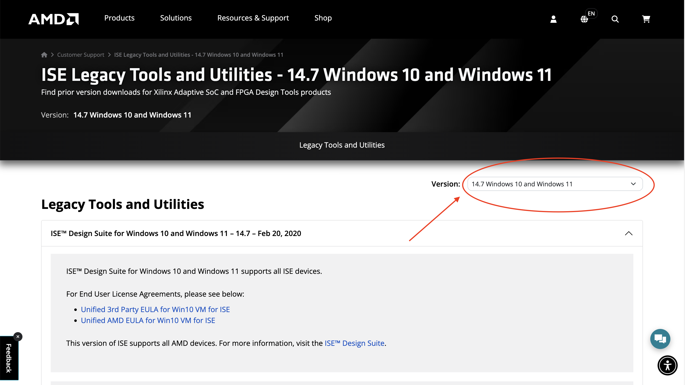

### Open the download page

Scroll down to the downloads area. Click the blue **14.7 Windows 10 and Windows 11** link under **Title**.

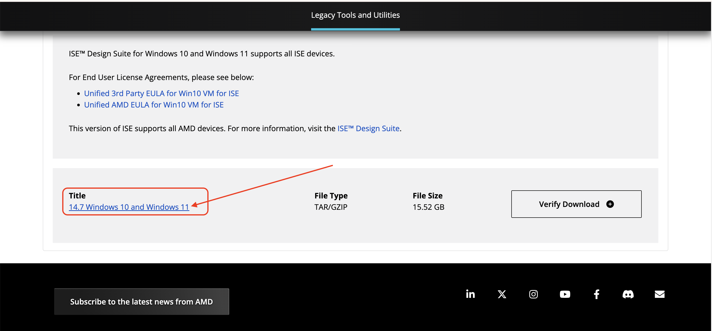

### Sign in to AMD

The link opens the AMD sign-in page. Sign in with your account, or create one first. Account registration is outside this tutorial.

> The platform validates download information. Check its requirements before entering your details; regional restrictions may apply.

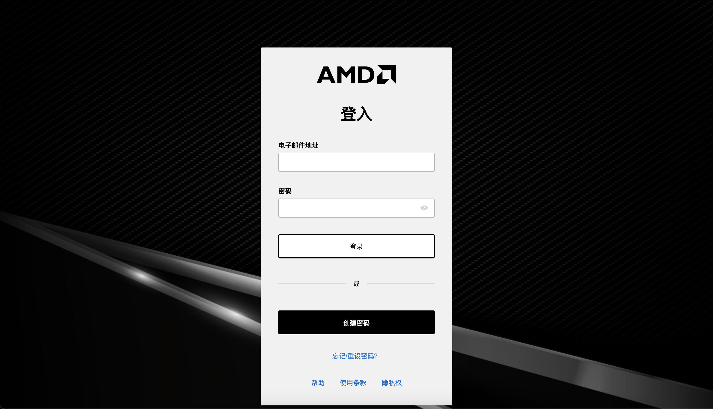

### Complete name and address verification

After signing in, complete the required fields marked with a red `*` on **Download Center - Name and Address Verification**. These include your name, company or institution, address, country or region, city, and role. Check the prefilled email address as well.

> These details must pass the platform's validation. Review its requirements and any regional restrictions before completing the form.

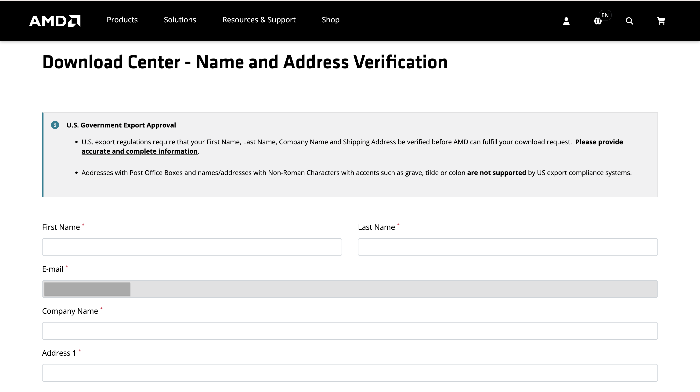

### Start the download

Scroll to the bottom and check that **Filename** contains **`VM`**, confirming that you selected the VM package. Click **Download**.

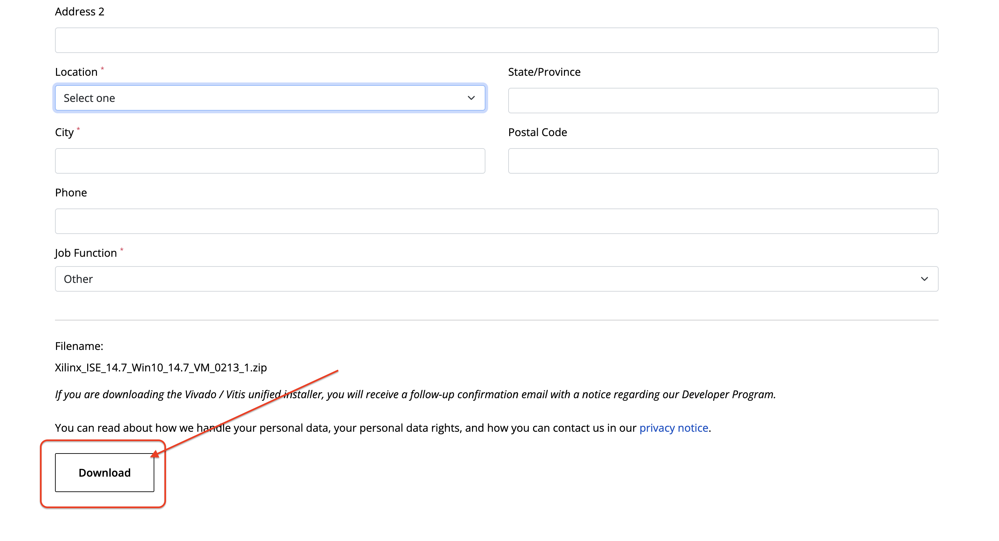

Wait for the download to finish before extracting the virtual disk.

## 2. Install Homebrew, QEMU, and UTM

Run the commands in this section in **Mac Terminal**.

### Homebrew

Homebrew is a package manager for macOS. Here it installs **QEMU**, whose `qemu-img` tool converts the official VM disk into the format used by UTM.

#### Check for an existing installation

Open Mac Terminal and run:

```sh
brew --version
```

A version number like the following means Homebrew is available. Continue to the QEMU section.

```text
Homebrew x.y.z
```

If no Homebrew version appears, for example `command not found: brew`, it may not be installed. If you have already installed it, check your terminal's PATH.

#### Install from the official website

Open [Homebrew's website](https://brew.sh/) and find **Install Homebrew**. Click the copy button shown below, paste the current official installation command into Mac Terminal, and run it.

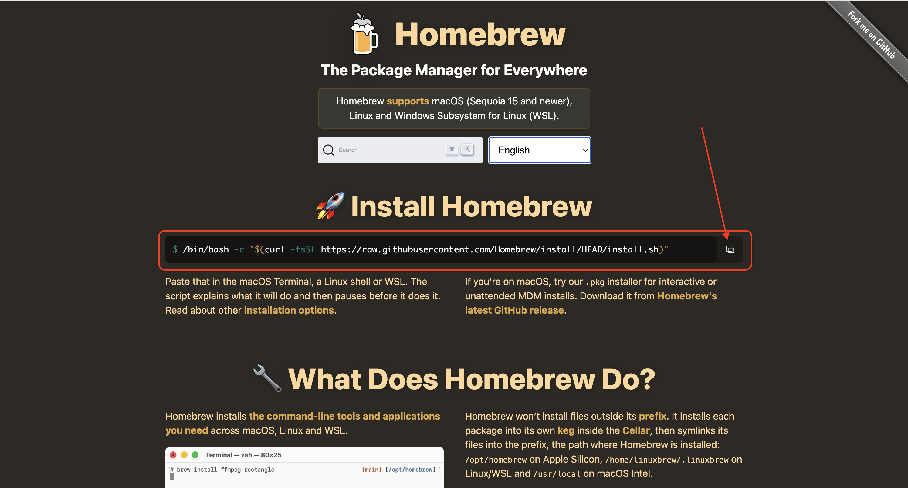

Follow the terminal prompts. Typical output includes:

```text
==> Checking for `sudo` access (which may request your password)...
==> This script will install:
...
Press RETURN/ENTER to continue or any other key to abort:
```

Installation may request your Mac administrator password. Press **Return / Enter** at the confirmation prompt and wait for completion.

Successful installation produces output similar to:

```text
==> Installation successful!
...
==> Next steps:
```

Run the commands listed under **Next steps** to add Homebrew to PATH. Then check again:

```sh
brew --version
```

Continue once a version appears. These examples come from the [official installer](https://github.com/Homebrew/install/blob/HEAD/install.sh); actual output varies by version and environment.

### QEMU

First check whether `qemu-img` is available:

```sh
qemu-img --version
```

If version information appears, proceed to the next step. If the command is unavailable, install QEMU using Homebrew and check again:

```sh
brew install qemu
qemu-img --version
```

### UTM

Open [UTM's website](https://mac.getutm.app/) and click **Download for Mac** to download the DMG.

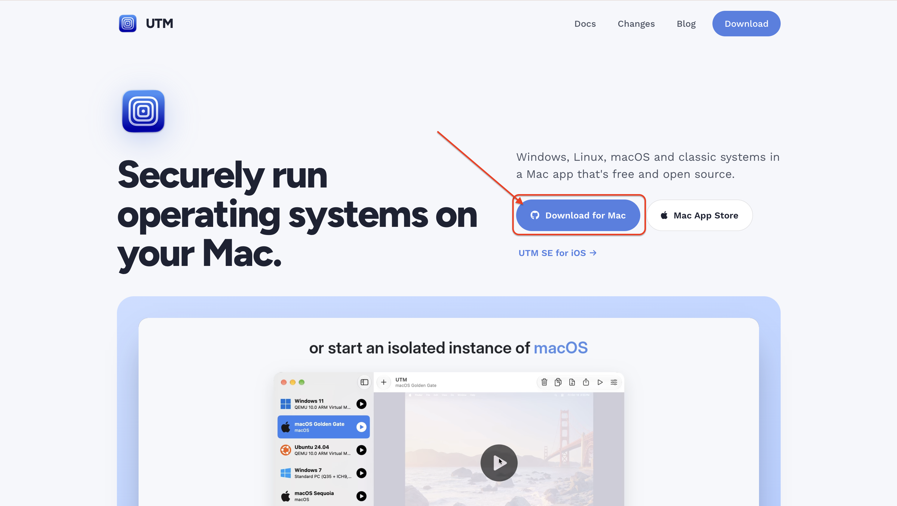

Open the downloaded DMG, drag UTM into **Applications**, and launch it from there.

## 3. Extract the VMDK

### Extract the download and find the OVA

Double-click the downloaded ZIP to extract it. Open the resulting folder, then its **`ova`** folder, and locate **`14.7_VM.ova`**.

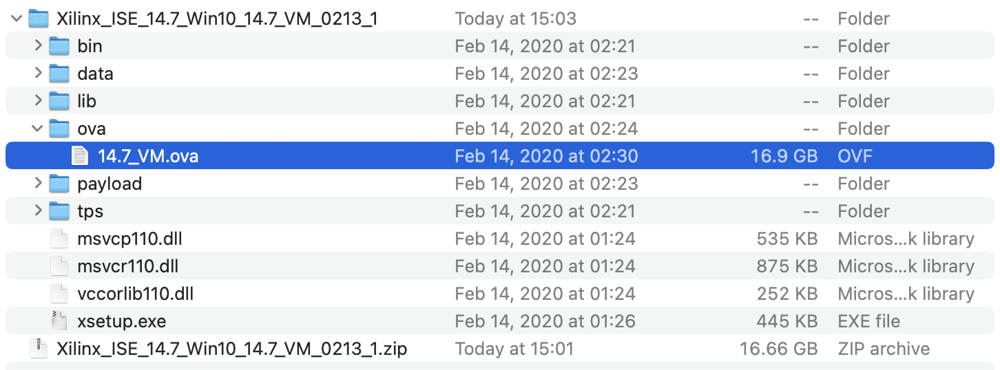

> Disk space: the package is large. Once extraction finishes, you can delete the original ZIP and empty that item from Trash to free space. The next step extracts the OVA again, so clearing space now helps.

### Extract again and keep the VMDK

Rename `14.7_VM.ova` to **`14.7_VM.ova.tar`**, then double-click it to extract. OVA uses the TAR archive format, which macOS Archive Utility can open.

Find **`14.7_VM-disk001.vmdk`** in the extracted folder. This is the virtual disk used in the next step.

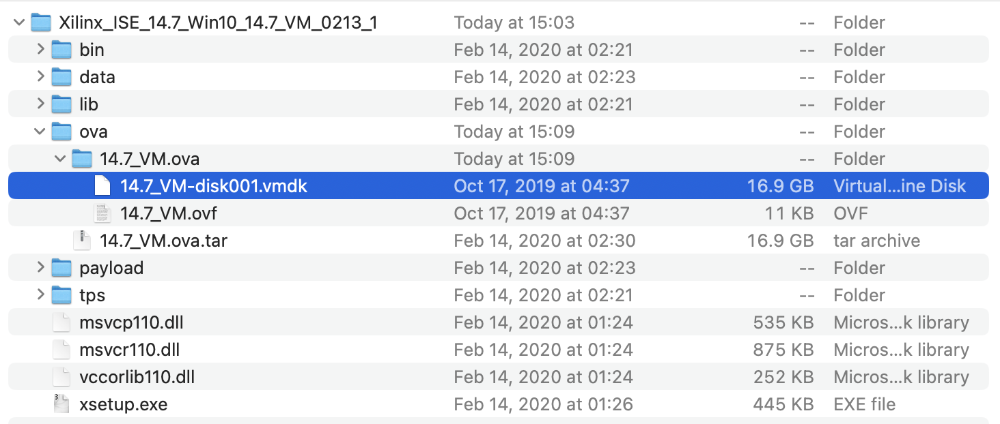

Move the VMDK to a suitable folder of your choice. You can then delete the remaining extracted directories, TAR, OVF, and other installation files, and empty those items from Trash.

## 4. Convert to compressed QCOW2

In Mac Terminal, type `cd` followed by a space. Drag the folder containing the VMDK from Finder into Terminal and press **Return / Enter**. This changes to that folder and handles spaces in its path.

Run:

```sh
qemu-img convert -p -f vmdk -O qcow2 -c \
  "14.7_VM-disk001.vmdk" "ISE_14.7_VM.qcow2"
```

The progress indicator updates during conversion, for example:

```text
    (2.00/100%)
```

Wait until it reaches **100%** and the command finishes normally, returning to the prompt. **`ISE_14.7_VM.qcow2`** will be in the current folder. Keep Terminal open during conversion.

| Option | Purpose |
| --- | --- |
| `-p` | Show progress |
| `-f vmdk` | Input format |
| `-O qcow2` | Output format |
| `-c` | Compress output data |

Check the QCOW2 structure after conversion:

```sh
qemu-img check -f qcow2 "ISE_14.7_VM.qcow2"
```

**`No errors were found on the image.`** means the structure check passed and you can import it into UTM. Keep the VM shut down during this check.

The VMDK may already be compressed, so the resulting QCOW2 is not necessarily smaller. Virtual capacity is the guest's upper storage limit; actual space used on the Mac depends on the contents and compression.

Keep **`ISE_14.7_VM.qcow2`** for import into UTM.

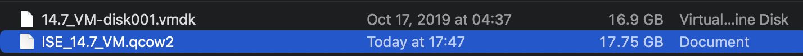

You can now delete the original **VMDK** and empty that item from Trash to free space.

## 5. Create the UTM VM

### Select emulation and architecture

Open UTM, click **＋**, and choose **Emulate**. Select **Linux** on the operating-system page.

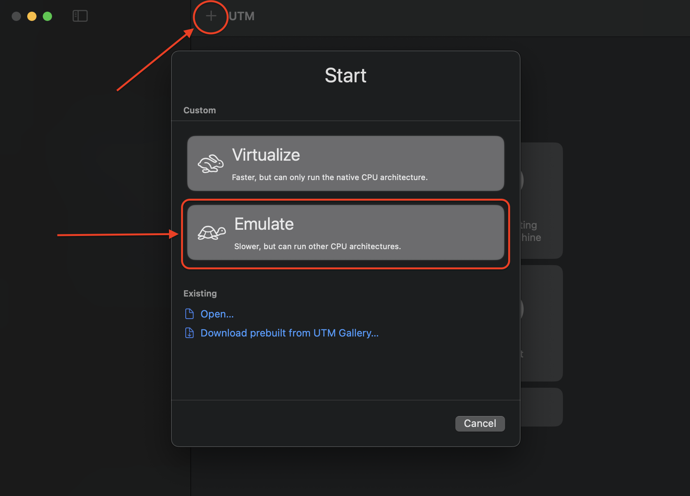

### Configure hardware and import the disk

Configure **Hardware** as shown on the left. Click **Continue**, choose **Import existing drive → Browse…** as shown on the right, and select `ISE_14.7_VM.qcow2`.

- Set memory to **1024 MiB (1 GiB)** for basic use; increase it for larger projects as needed.
- This guide uses an **8-core M1 Pro** with **6 virtual CPU cores**. Adjust the allocation for your Mac.
- This guide uses **qxl-vga**, with OpenGL acceleration disabled. [UTM display documentation](https://docs.getutm.app/settings-qemu/devices/display/)

| Hardware | Import the disk |
| :---: | :---: |
| 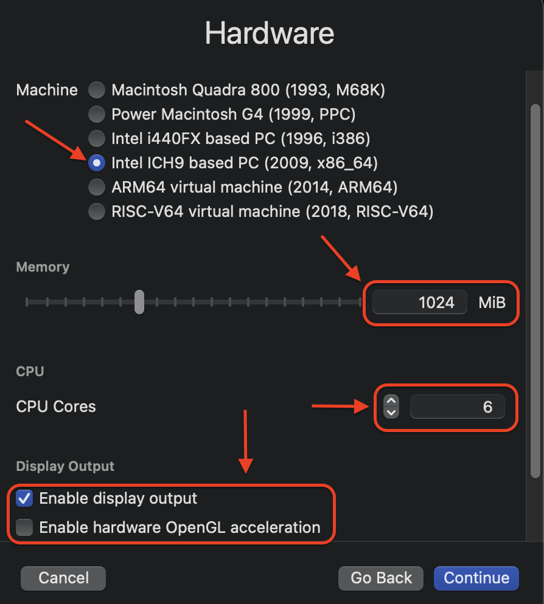 | 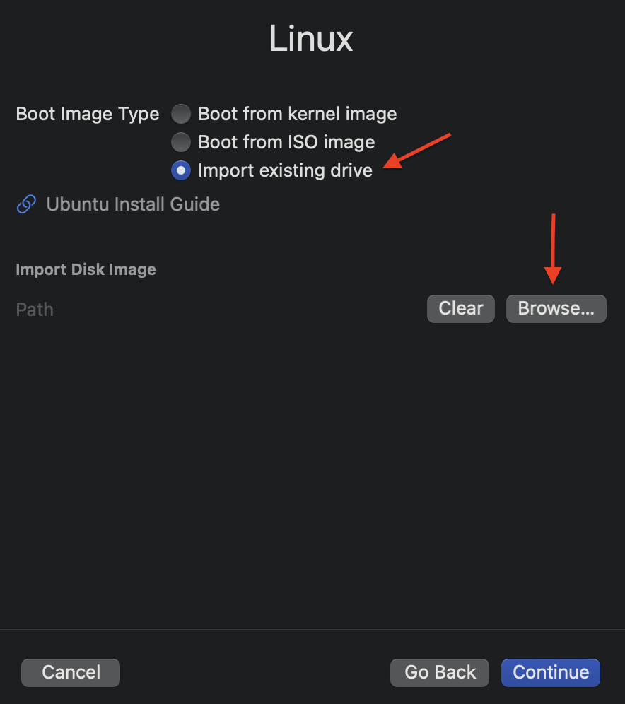 |

### Skip shared directories and review the configuration

Leave the path empty on **Shared Directory** and click **Continue**. This old guest image cannot directly use this shared-folder feature; Netatalk will handle file transfers later.

Name the VM at the top of **Summary**, for example `ISE 14.7 VM`. Check **Architecture, System, RAM, CPU, Storage**, and **Hardware OpenGL Acceleration** against the settings above.

For this image, **Storage** should show **64 GB**, indicating that UTM has read the imported disk's virtual capacity. The image occupies less space on the Mac. Click **Save**.

| Skip shared directories | Name and review the VM |
| :---: | :---: |
| 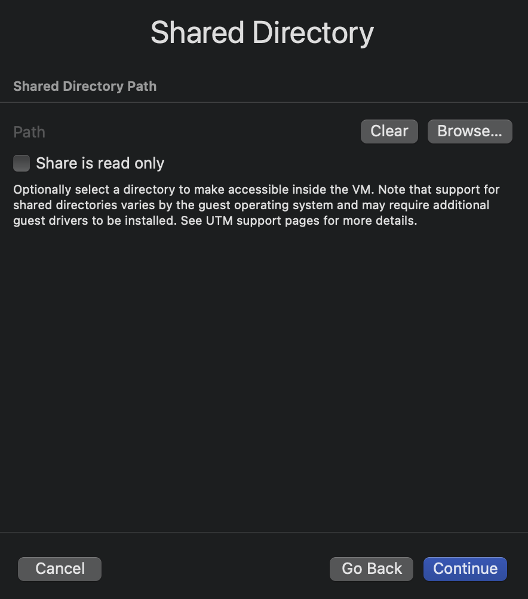 | 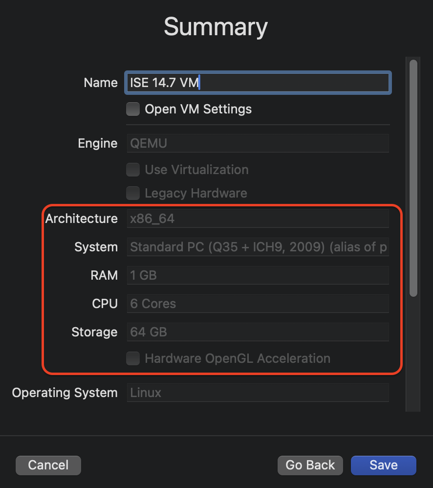 |

After **Save**, UTM shows a spinning indicator while copying the disk into its own VM directory.

### Open the VM settings

Once the spinner disappears, the VM appears in UTM's main window. Right-click it and select **Edit**. Review the CPU, boot, and display settings below; scrolling preferences follow later.

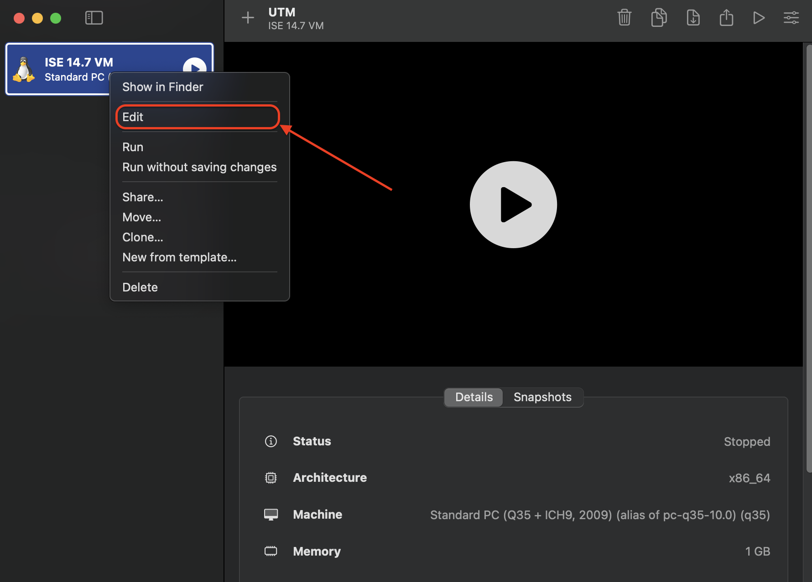

The imported disk copy may be larger than the compressed source image. In this example, Finder shows a **41.45 GB** `.utm` bundle. After configuring the VM, compress it again in section 6.

UTM now uses the disk copy in its own directory. If space is limited, delete the original external **QCOW2** and empty that item from Trash.


### Enable multicore emulation

In **System**, enable **Force Multicore**, which is disabled by default. This allows the allocated virtual CPUs to be emulated in parallel and can improve performance. Leave CPU and JIT Cache at **Default**. [UTM CPU settings](https://docs.getutm.app/settings-qemu/system/)

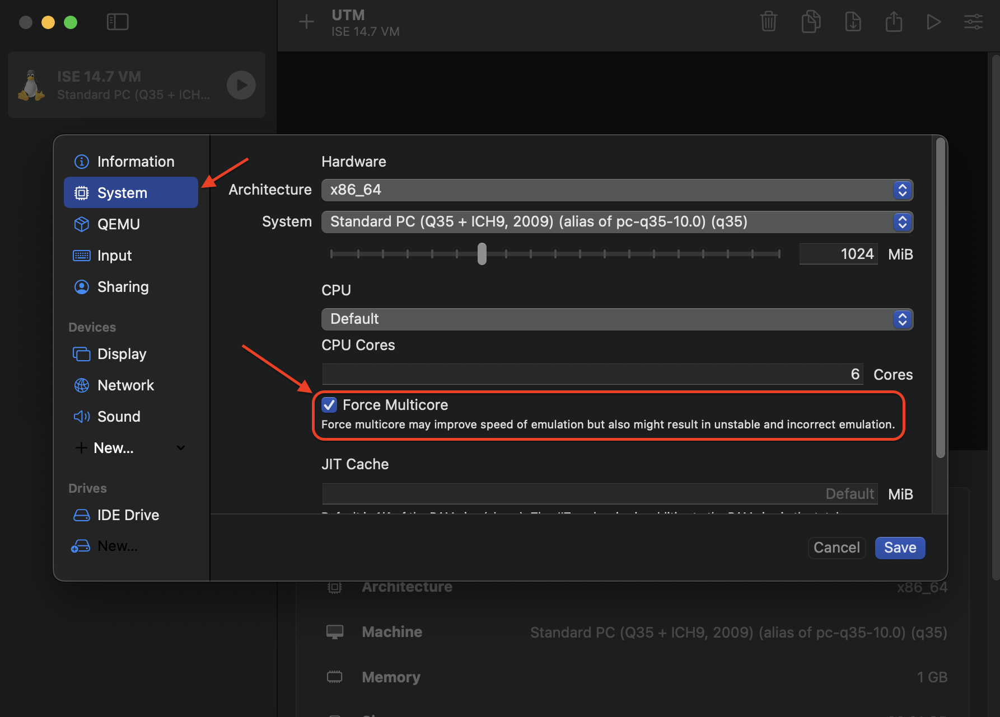

### Set the boot mode

In **QEMU**, disable **UEFI Boot**. This official image uses legacy BIOS boot.

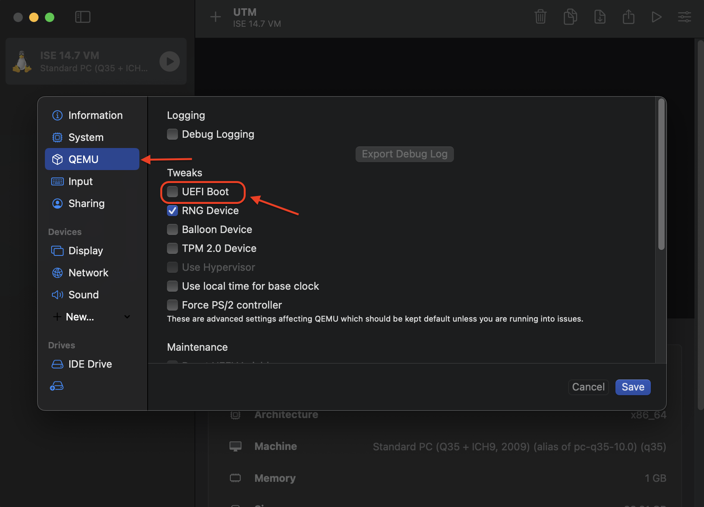

### Select the display device

In **Display → Emulated Display Card**, select the device compatible with this guest:

**Spice QXL GPU (primary, vga compatible) (qxl-vga)**

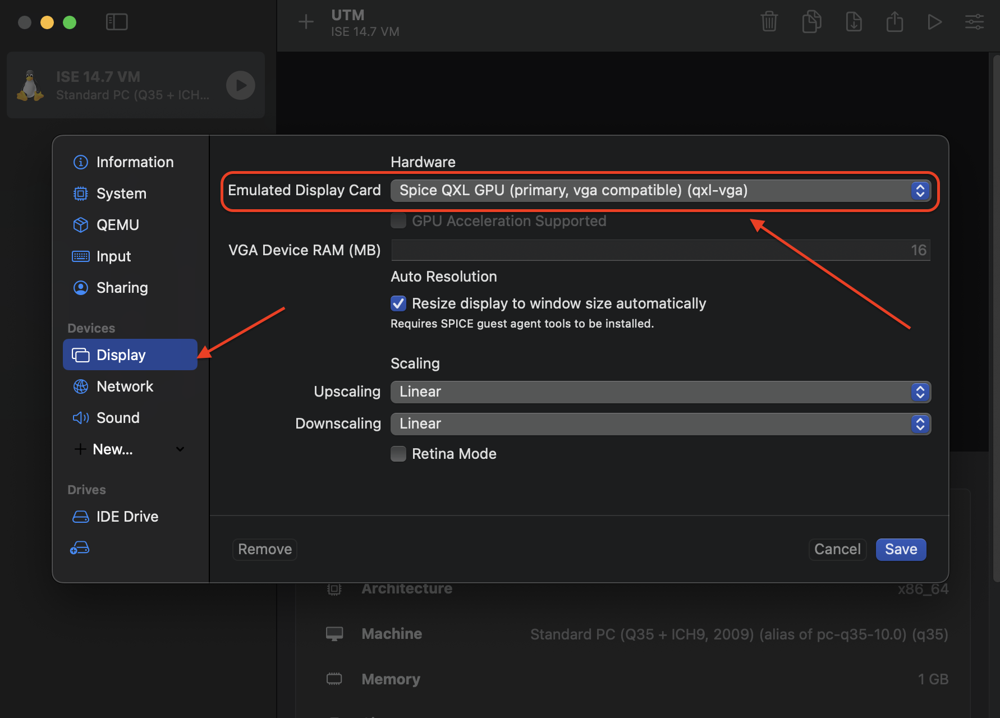

Leave the scaling options at their defaults. Automatic resolution changes and clipboard integration require SPICE support in the guest.

### Disk and network

Use **IDE** for the system disk and **Shared Network / e1000** for networking. Keep the system disk first in the boot order. Save the settings, then compress the disk and attach the Netatalk disc.

## 6. Compress the disk in UTM

UTM saves a disk copy inside the `.utm` bundle during import. **Save the imported configuration before reopening the disk settings to compress it.**

Keep the VM **Stopped**. If it is running, shut it down normally from Linux first.

**Compression needs temporary free disk space.** Clear the downloaded package, extracted files, and original external QCOW2 once they are no longer needed, then empty those items from Trash to make room.

1. Select the system disk's **IDE Drive** in the settings sidebar.
2. Click **Compress**, then **Reclaim** in the confirmation dialog.
3. Wait for the progress bar to finish, review **Size**, and save.

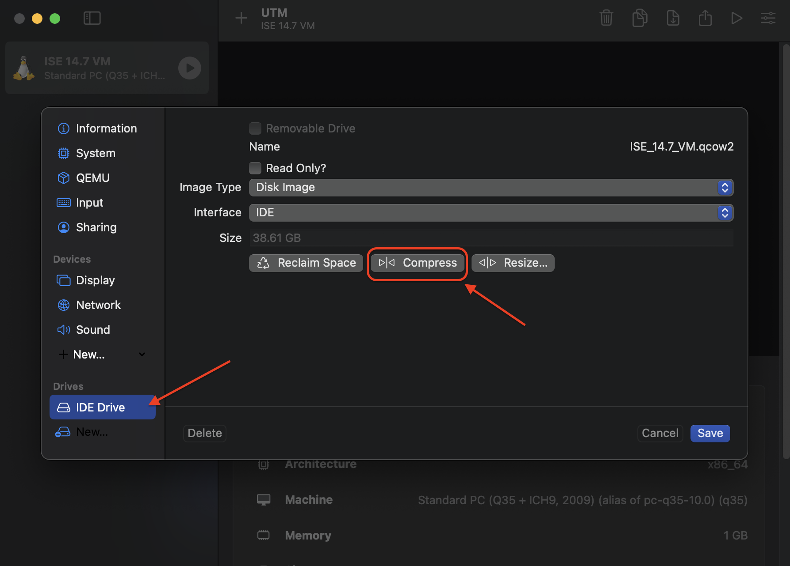

**Reclaim Space** frees unused space, **Compress** reclaims and compresses data, and **Resize** expands capacity. Choose **Compress** here, then continue to the Netatalk disc.

## 7. Install Netatalk file sharing

### Why add this disc?

This section sets up file sharing between the Mac and VM. Install it if you need this feature. [Download the Netatalk offline disc](../../downloads/ISE_NETATALK_3.1.7.iso) (approximately 6.8 MB).

The official image's original shared-folder setup depends on VirtualBox and cannot be used directly in UTM. This guide installs Netatalk so Mac Finder can access Linux files over AFP.

The offline disc avoids installing development tools and compiling from source. Its installer uses the existing **ise** account, configures the share, and permits the required firewall access.

See [Netatalk disc contents and configuration](netatalk-disc.en.md) for the source files, shared-folder settings, and firewall details.

### Attach the Netatalk disc

After compression:

1. Click **New… (＋)** under **Drives** in the sidebar. Enable **Removable** and select **IDE**. Attaching the ISO as removable media references the original file and avoids importing another fixed-disk copy.
2. Click **Browse…** and select `ISE_NETATALK_3.1.7.iso`.

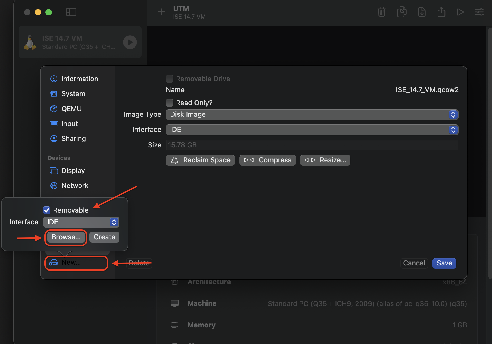

Confirm that a new drive appears, **Path** names the ISO, **Image Type** is **CD/DVD (ISO) Image**, and **Removable Drive** is checked. Keep the system disk first in the boot order. Click **Save** to finish the VM configuration.

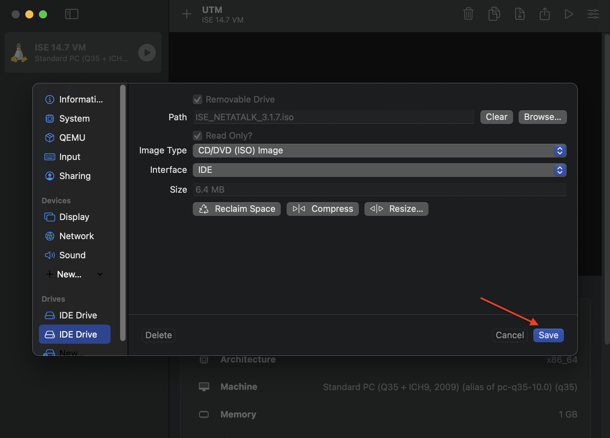

Keep the ISO at the selected location while it is attached.

### Match the scrolling direction

After saving the VM settings, adjust scrolling to match the Mac's natural-scrolling behavior.

Open **UTM → Settings…** from the menu bar at the top left.

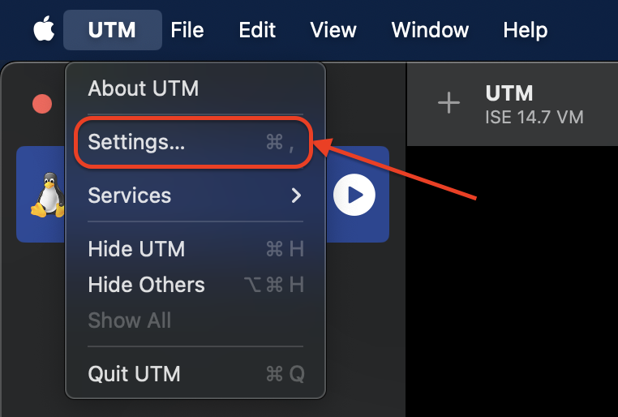

Select **Input**, then enable **Invert scrolling** under **QEMU Pointer**.

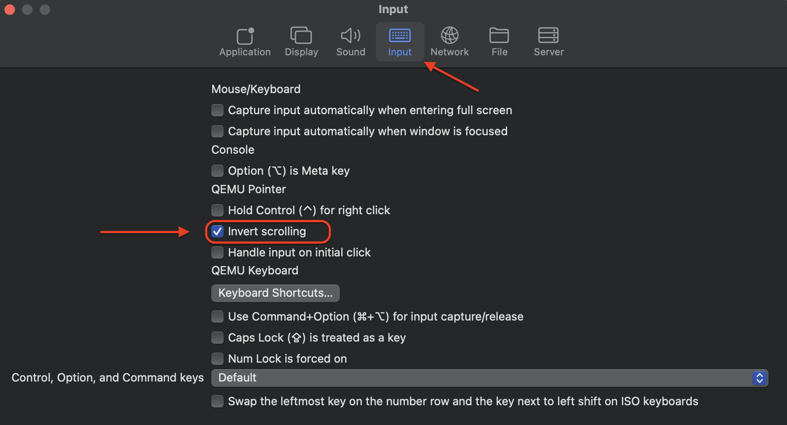

### Start the VM

Return to UTM's main window, select the VM, and click Start. Wait for Oracle Linux to reach the desktop.

| Starting up | Desktop |
| :---: | :---: |
| 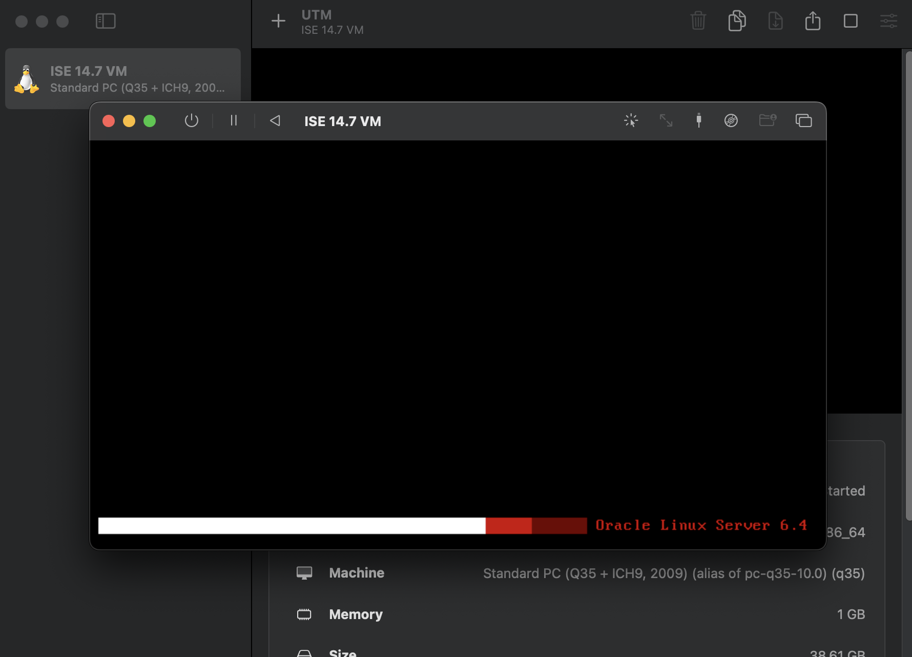 | 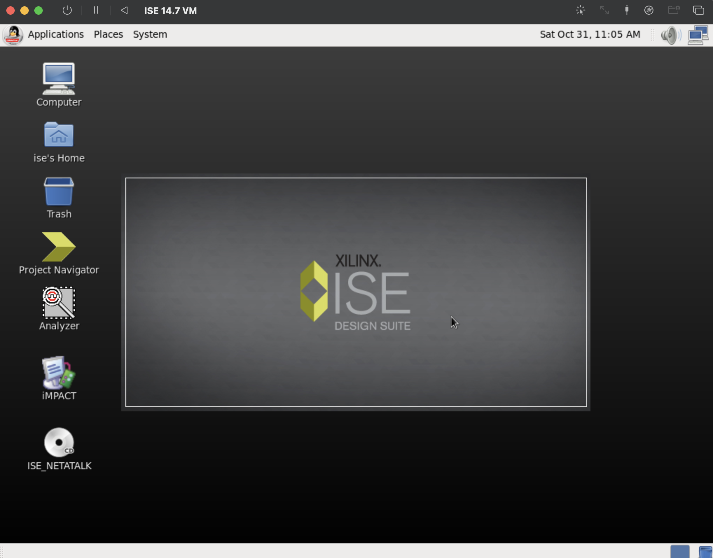 |

Reaching the desktop shown on the right confirms that the VM has booted successfully.

### Install from the disc

Double-click **ISE_NETATALK** on the desktop, then double-click **Install Netatalk** inside the disc.

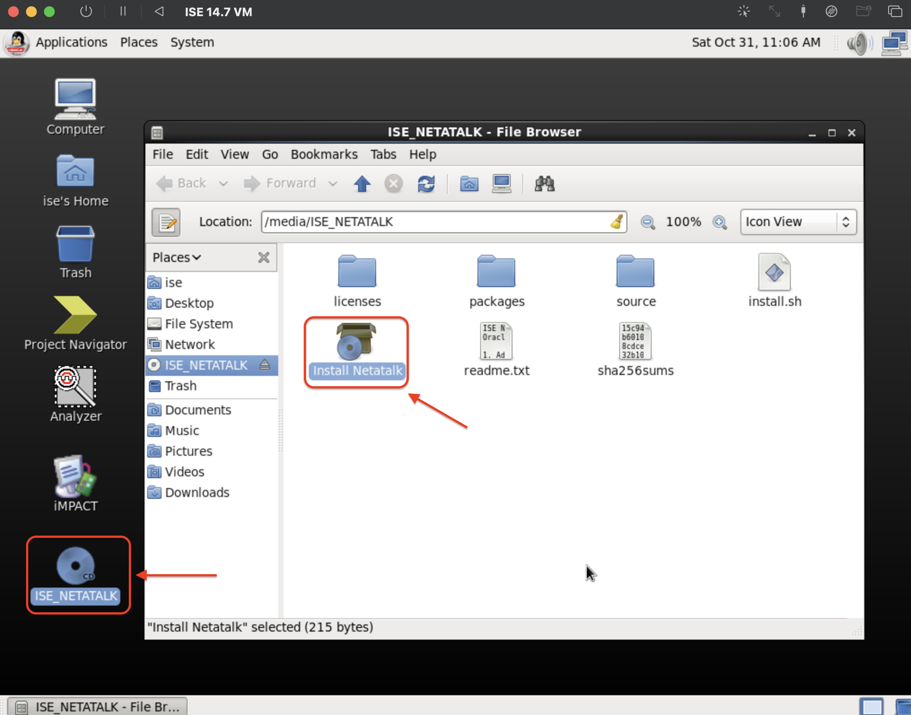

Review the shared directory, account, and network scope, then press **Enter** to install. Enter the current ise password if prompted. Once **Installation complete** appears, note the `afp://…` address and press **Enter** again to close the window.

| Confirm installation | Installation complete |
| :---: | :---: |
| 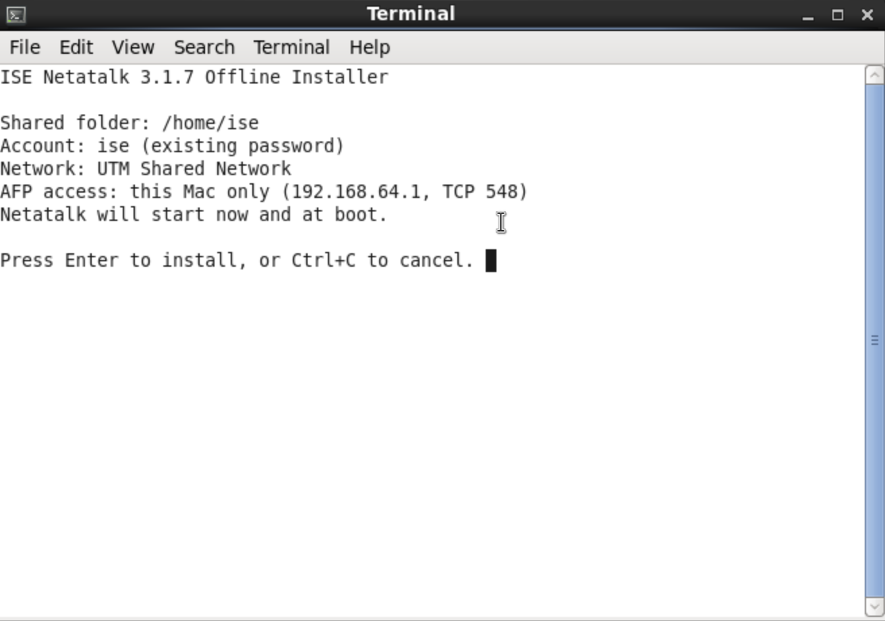 | 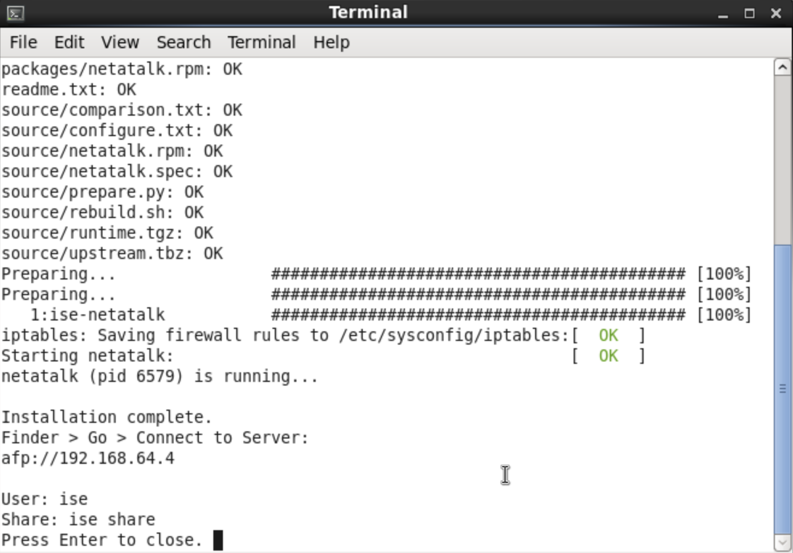 |

The service starts automatically and runs at boot. If you forget the address, open **Terminal** and use `ifconfig` as described below.

## 8. Find the VM address and connect over AFP

### Find the IP in Linux

Open **Applications → System Tools → Terminal** at the top left of the VM desktop. Run `ifconfig` to view the IP address.

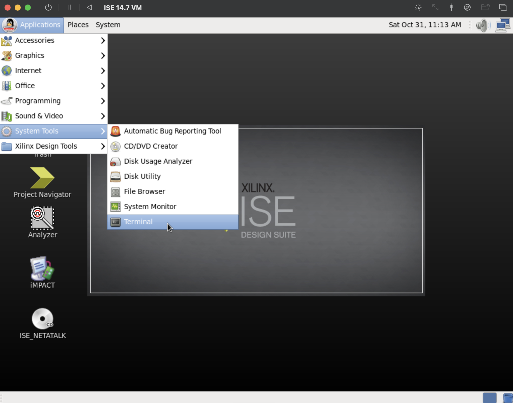

### Connect from Finder

On the Mac, open Finder and choose **Go → Connect to Server…**, or press **Command+K**.

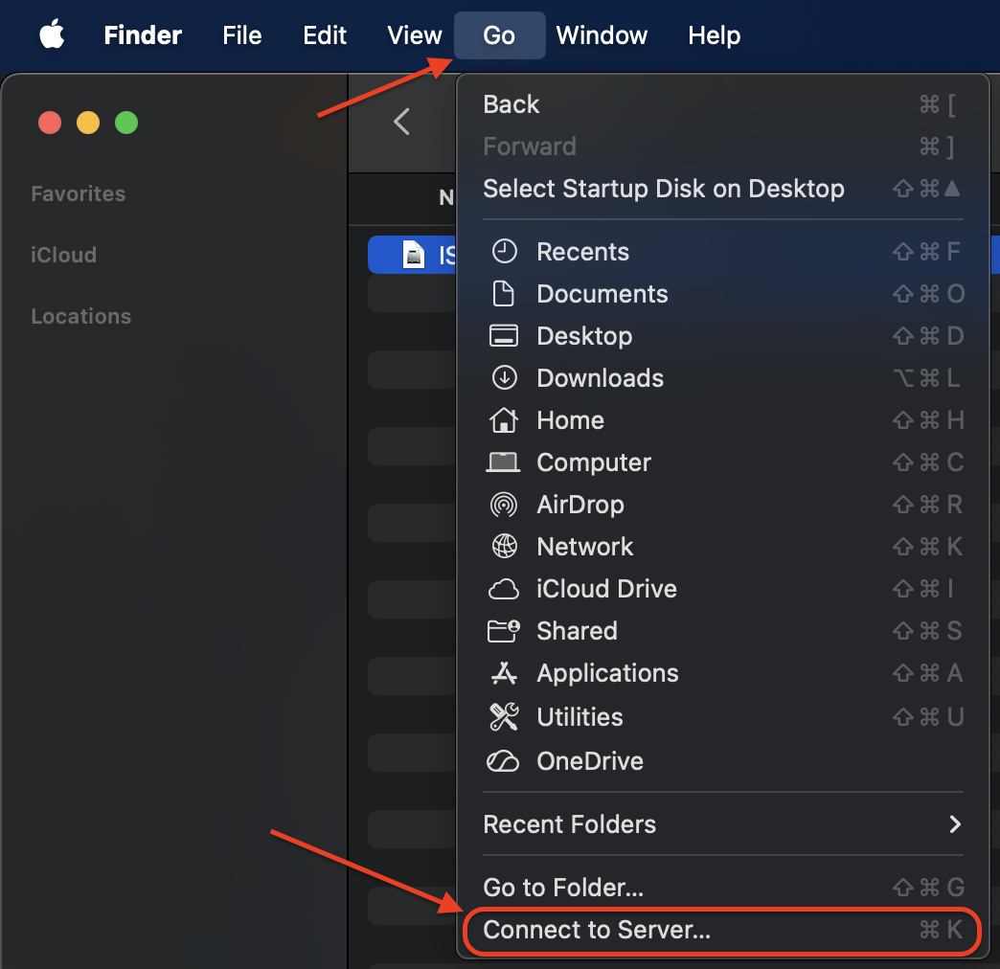

Enter `afp://` followed by the VM's IP, such as `afp://192.168.64.4` in the screenshot. Click **＋** at the lower left to save it as a favorite for next time, then click **Connect**.

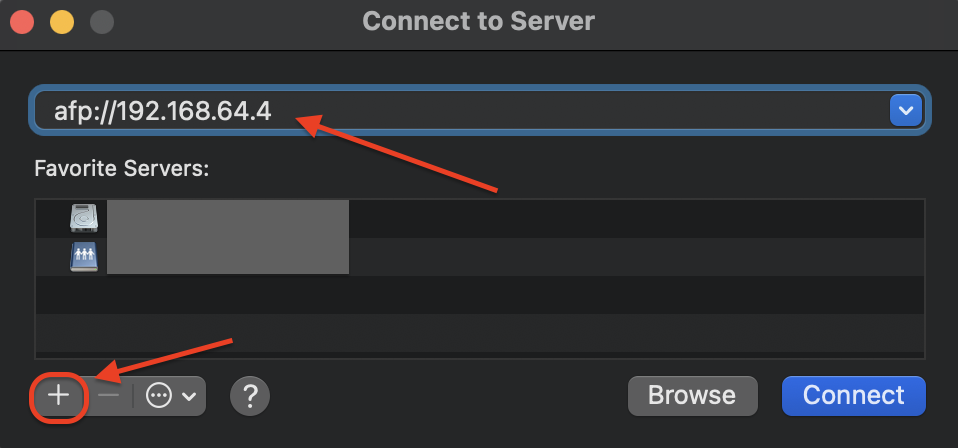

Use **`ise`** as the username. If you have not changed the Linux password, enter **`xilinx` (all lowercase)**; otherwise use your current password. Optionally enable **Remember this password in my keychain**, then click **Connect**. [Official default-account documentation](https://docs.amd.com/r/en-US/ug1227-ise-vm-windows10/ISE-Virtual-Machine-Login-and-Permissions)

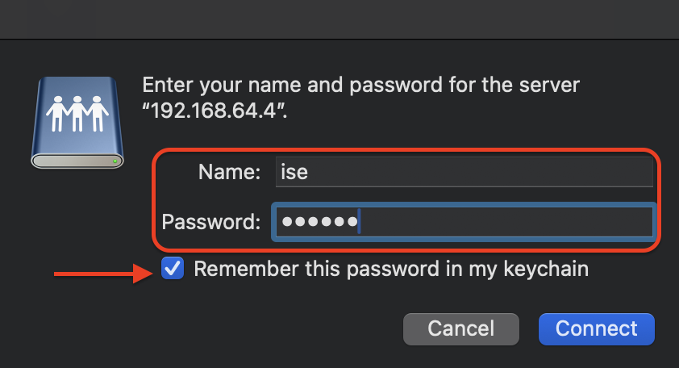

When Finder opens **ise share** and lists its folders, the connection is established. This share maps to `/home/ise` in the VM. You can now drag or copy files between the Mac and VM.

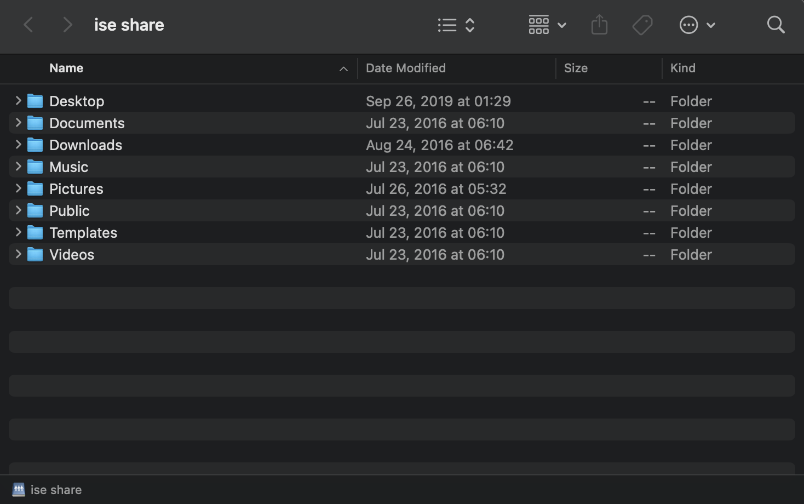

### Check file transfers

Copy a test file from the Mac to the share, then create another file in Linux and copy it back to the Mac. Check the contents in both directions. Build ISE projects in a local Linux directory.

If the connection fails, check the IP, service status, and access to AFP on TCP 548:

```sh
sudo service netatalk status
/usr/local/sbin/afpd -V
```

## 9. Launch ISE

Double-click **Project Navigator** on the VM desktop and wait for the **ISE Project Navigator** window to open. On first launch, click **OK** to close **Tip of the Day**. Optionally clear **Show Tips at Startup** to hide it on future launches.

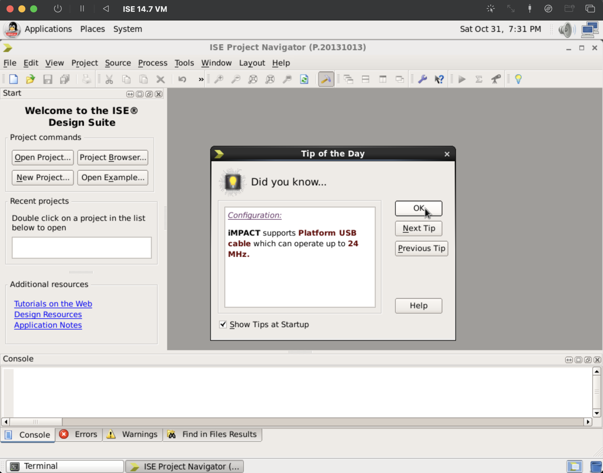

## References

- Kevin Patterson: [Running the Xilinx ISE on an M1 MacBook Pro](https://www.youtube.com/watch?v=h4-FIYJfRUE), 2022. Main reference for this workflow.
- Dmitry Dovidenko: [Netatalk 3.1.7 on CentOS 6.6 x86_64](https://dovidenko.com/2015/359/howto-compiling-installing-configuring-netatalk-3-1-7-centos-6-6-x86_64-storage-time-machine.html), 2015. Reference for Netatalk compilation and service configuration.
