# 在 Windows 11 上原生安装 Xilinx ISE 14.7

[简体中文](README.md) | [English](README.en.md) · [项目总览](../../README.md)

本教程使用传统 Windows 原生 ISE 14.7 安装包，配合安装辅助完成安装过程中的已知兼容性处理。

## 开始前：准备安装辅助

先下载 [ISE 安装辅助](../../downloads/ISE-Helper.cmd)。

将脚本保存在便于找到的位置，稍后在运行官方安装程序之前先启动它。

辅助的组成、运行原理和修复来源见 [ISE 安装辅助技术说明](helper.md)。

## 1. 下载官方 Windows 原生安装包

### 确认 Version 为 14.7

打开 [AMD 官方 ISE 下载页](https://www.amd.com/en/support/downloads/adaptive-socs-and-fpgas/legacy-ise/v2012_4---14_7.html)。在页面右侧的 **Version** 下拉菜单中，确认选择的是 **14.7**。

**14.7 Windows 10 and Windows 11** 对应官方虚拟机方案；本教程需要的是 **14.7** 中的传统 Windows 原生安装包。

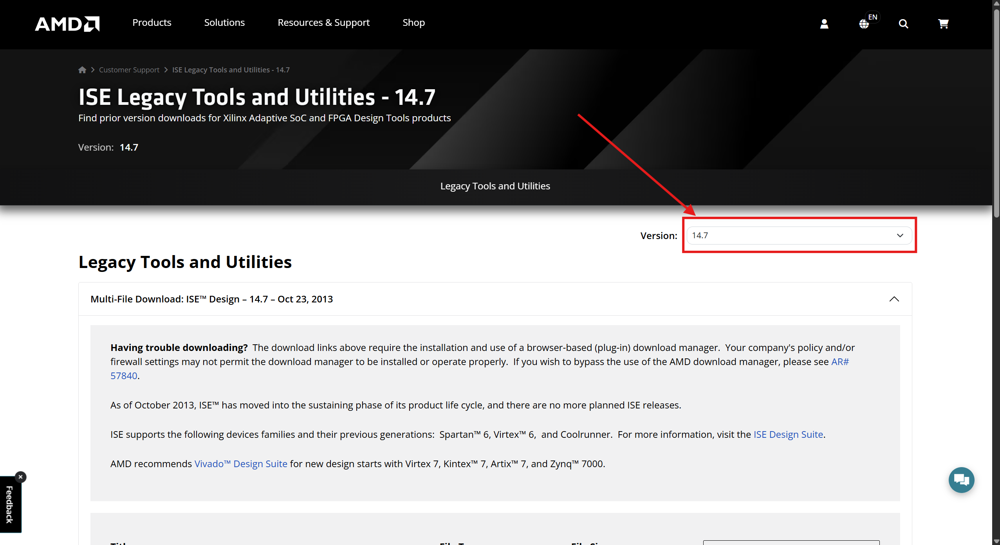

### 展开 ISE Design Suite 下载区域

向下滚动，展开 **ISE Design Suite – 14.7 – Oct 23, 2013** 这一栏。在其中找到并点击蓝色的 **Full Installer for Windows 7/XP/Server** 链接，如下图箭头所示。这就是本教程使用的 Windows 原生安装包下载入口。

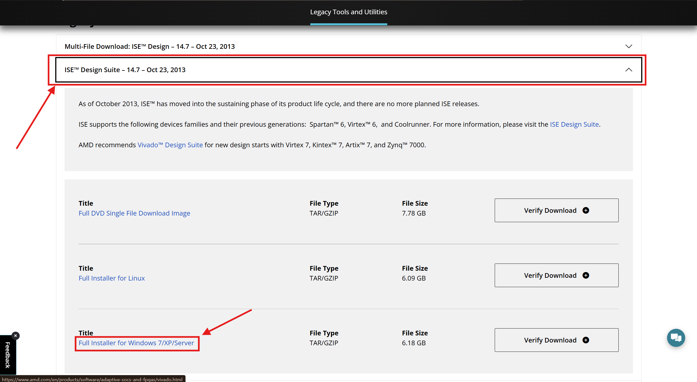

### 注册和登录 AMD 账号

点击下载标题后，页面会跳转到 AMD 账号登录界面。使用已有账号登录；首次使用需先创建账号，本文省略具体注册流程。

> 提示：平台会对下载资料进行验证，请注意填入的资料需符合其要求，可能对地区有一定限制。

### 完成姓名和地址验证

登录后进入 **Download Center - Name and Address Verification** 页面，填写带红色星号 `*` 的必填项，包括姓名、公司或机构、地址、国家或地区、城市和职能，并核对预填的邮箱。

> 提示：本页资料需通过平台验证，填写前请留意其要求及可能的地区限制。

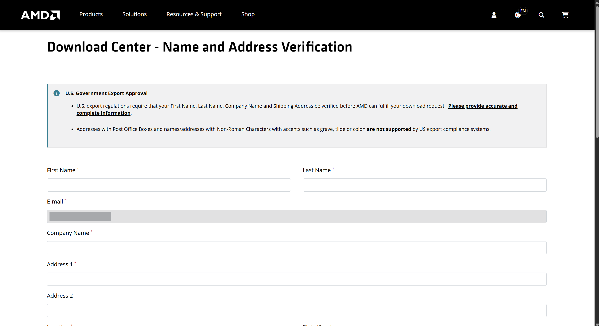

### 核对原生安装包并开始下载

填写完成后，滚动到页面底部，确认 **Filename** 中**不包含 `VM`** 字段，下载的是 Windows 原生安装包，再点击 **Download** 开始下载。

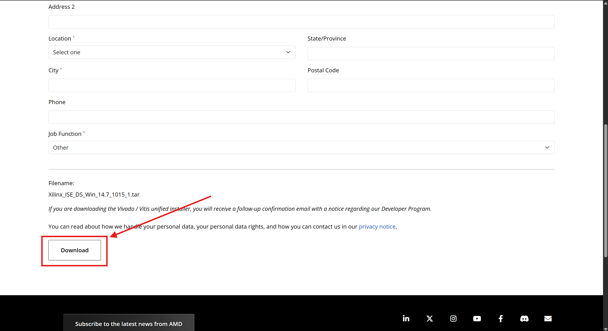

等待下载完成，后续解压原生安装包。

## 2. 解压安装包，找到官方安装程序

下载完成后，右键点击安装包，将其解压到文件夹。

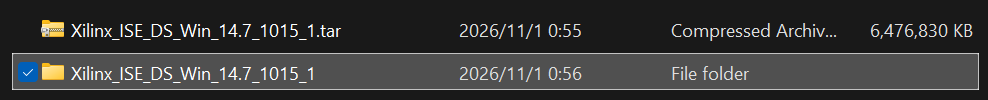

进入解压后的文件夹，找到 **xsetup.exe**，这就是官方安装程序。

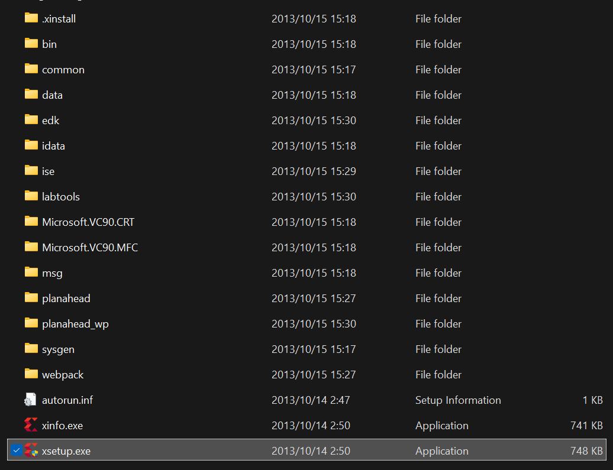

先找到这个文件，下一步先启动安装辅助，再运行 **xsetup.exe**。

## 3. 启动安装辅助

打开前面下载好的安装辅助 **ISE-Helper.cmd**。

双击脚本，在弹出的 Windows 权限提示中允许管理员权限，等待辅助显示准备就绪。随后保持辅助窗口打开，双击前面找到的 **xsetup.exe**，启动官方ISE安装程序。辅助会自动识别安装器并开始监视安装进度，如下图所示。

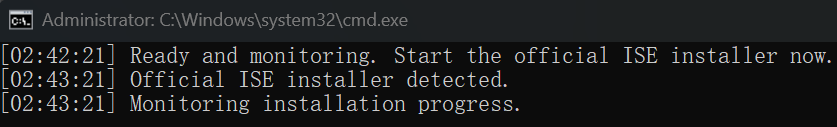

看到以上提示后，回到ISE安装向导，正常点击 **Next** 继续即可，辅助窗口保持打开。

推荐在官方安装器之前启动辅助。如果已经开始安装，也可以打开辅助，让它识别仍在运行的安装器；留意窗口是否显示已识别安装程序及安装目录。

## 4. 接受协议并选择安装版本

进入安装向导后，阅读许可协议；确认同意后勾选接受条款，点击 **Next** 继续，直到出现 **Select Products to Install** 页面。

根据自己的需要选择安装版本，然后点击 **Next**。

本教程以工具覆盖最全的 **System Edition** 为例进行安装。

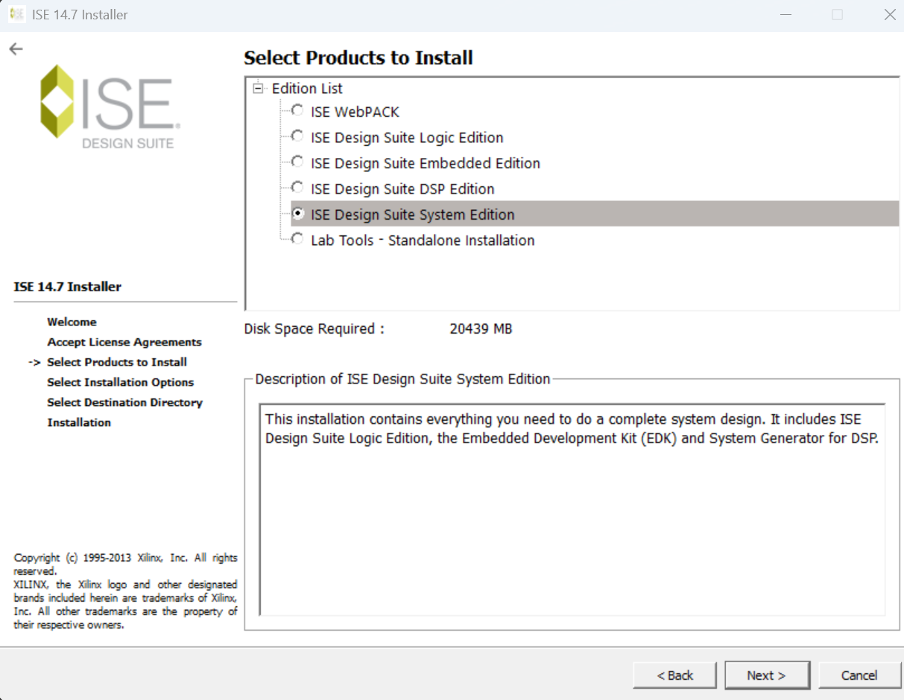

这里的选项用于选择安装的工具组合，主要区别如下：

| 选项 | 主要用途与区别 |
| --- | --- |
| **ISE WebPACK** | 免费许可的开发工具，提供逻辑设计、综合、实现和仿真等功能，支持的器件范围有限；安装的附加工具可能仍需单独许可。 |
| **ISE Design Suite Logic Edition** | 面向逻辑设计，包含设计输入、综合、实现和验证工具，是其他套件版本的基础。 |
| **ISE Design Suite Embedded Edition** | 在Logic Edition基础上增加嵌入式开发工具和IP，用于MicroBlaze等处理器系统开发。 |
| **ISE Design Suite DSP Edition** | 在Logic Edition基础上增加System Generator for DSP及相关IP，面向数字信号处理设计。 |
| **ISE Design Suite System Edition** | 汇集Logic、Embedded和DSP三个版本的工具、技术及IP，是这些套件版本中功能最完整的组合。 |
| **Lab Tools – Standalone Installation** | 单独安装实验室下载、配置及调试工具，用于已有设计的板上操作，不提供完整的综合与实现开发流程。 |

版本功能依据[Xilinx ISE Design Suite 14官方产品说明（2012）](https://www.xilinx.com/publications/prod_mktg/ISE_sellsheet.pdf)及[ISE 14.7安装与许可指南UG631（2020修订）](https://www.amd.com/content/dam/amd/en/documents/products/adaptive-socs-and-fpgas/fpga/6-series/irn.pdf)整理。安装组件与可用授权是两回事，具体工具及IP的使用仍以许可证为准。

## 5. 选择安装选项

进入 **Select Installation Options** 页面。本次按下图设置：保留顶部的多核安装选项，列表中勾选 **Install Cable Drivers**，取消其余三项。

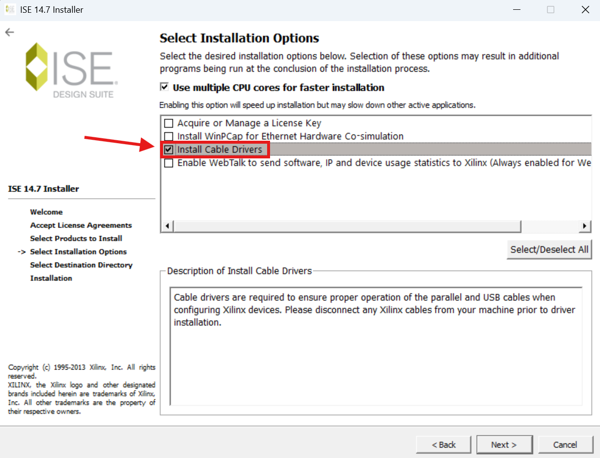

| 选项 | 用途与本次选择 |
| --- | --- |
| **Use multiple CPU cores for faster installation** | 使用多个CPU核心执行安装，保持勾选。 |
| **Acquire or Manage a License Key** | 安装结束时自动打开许可管理器。本流程取消勾选，先完成DLL修复，再配置许可证。 |
| **Install WinPcap for Ethernet Hardware Co-simulation** | 用于以太网硬件协同仿真。WinPcap已停止支持，官方提示可能与新版Windows存在兼容性问题；普通HDL设计、软件仿真和USB下载不需要这一项，本次取消勾选。 |
| **Install Cable Drivers** | 安装下载线驱动，供连接硬件、配置器件使用，本次勾选。安装驱动前先断开Xilinx下载线。 |
| **Enable WebTalk…** | 可能影响安装进度，能取消就取消；无法取消时，辅助会处理安装过程中的相关进程。它与仿真计算无关，本次取消勾选。 |

WinPcap兼容性说明见[WinPcap官方下载页](https://www.winpcap.org/install/)。

确认选项后，点击 **Next** 继续。

## 6. 选择安装位置和开始菜单名称

进入 **Select Destination Directory** 页面。ISE占用空间较大，可以点击 **Browse…**，选择空间充足、适合存放软件的位置，并核对页面显示的所需空间与可用空间。

保持 **Create Start Menu and Desktop Icons** 勾选。下方 **Select a Program Folder** 用于设置开始菜单程序列表中的名称；本次将名称改为 **Xilinx ISE Design Tools**，加入 **ISE**，方便与Vivado区分。

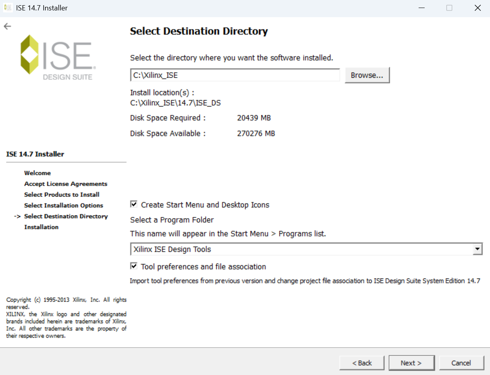

确认后点击 **Next** 继续。

## 7. 确认安装内容

下一页是 **Options Summary**，汇总将要安装的组件、选项和目标路径。核对内容后，点击 **Install** 开始安装，并保持辅助窗口打开。

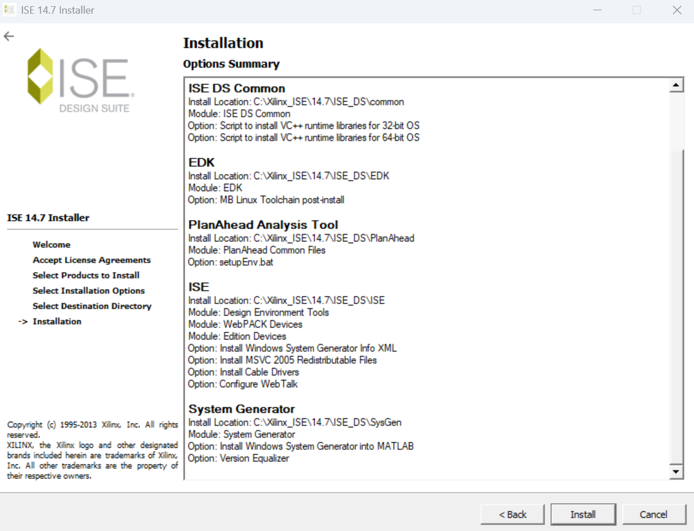

本次选择的System Edition包含 **System Generator**，提供与MATLAB整合的功能。由于ISE版本较老，与所用MATLAB版本的兼容性需要确认；本教程先跳过MATLAB关联。安装中的 **Version Equalizer** 阶段也可能停留，辅助会自动检测并处理，让安装继续。

## 8. 完成安装与自动修复

开始安装后，等待进度推进，并保持辅助窗口打开。安装过程中常见的WebTalk停留问题会由辅助自动处理，处理结果会显示在辅助窗口中。

进行到 **Install Cable Drivers** 时，会弹出 **Cable Driver Installer** 提示。先断开电脑上的Xilinx USB下载线或开发板JTAG连接，再手动点击 **OK**，安装才会继续。

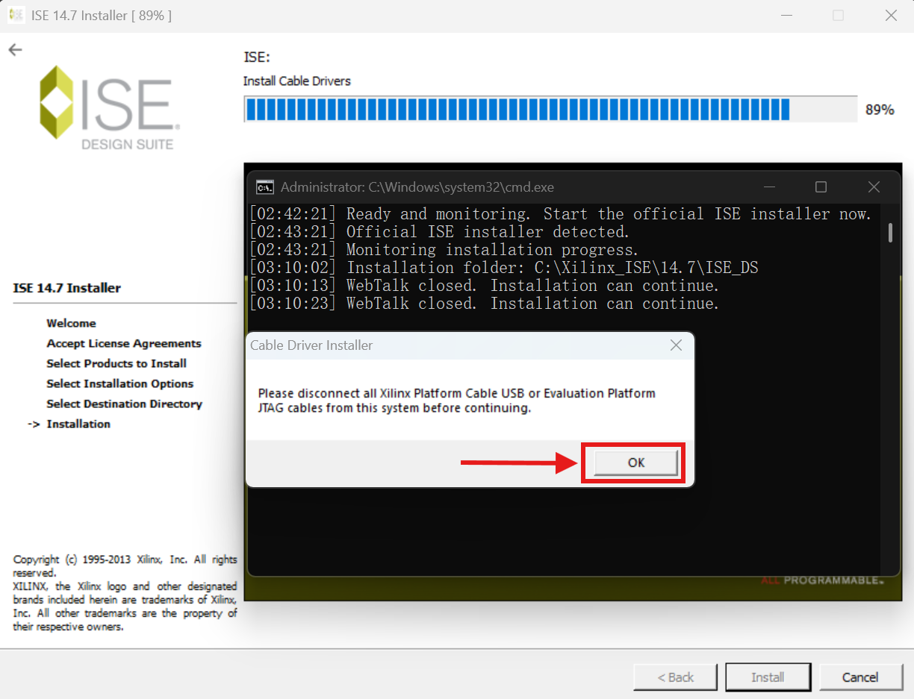

接下来可能弹出System Generator与MATLAB关联窗口。虽然它能识别本机安装的MATLAB，但我们尚未验证这两个版本能否配合正常使用，目前也暂时用不到这项功能，因此保持未勾选，直接点击窗口右上角的 **×**，关闭后继续安装。

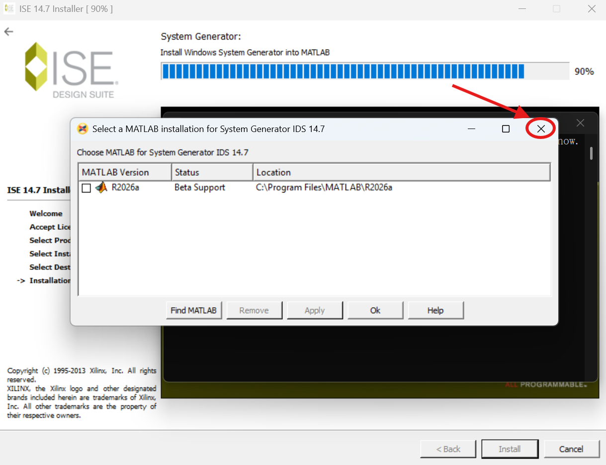

关闭MATLAB关联窗口后，继续等待。辅助会自动检测并处理停留的 **Version Equalizer** 任务，随后安装进度继续推进，直至显示 **Install Completed**。

在安装完成页面点击右下角的 **Finish**，退出官方安装器，保持辅助窗口打开。

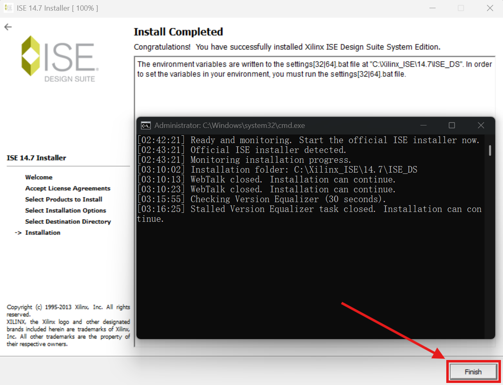

安装器关闭后，辅助会自动检查安装结果、生成修复副本，备份并替换DLL，随后设置启动检查所需的用户环境变量。如果ISE或许可证管理器自动打开，先将其关闭，让辅助继续处理。

| 自动检查并替换DLL | 修复完成 |
| --- | --- |
| 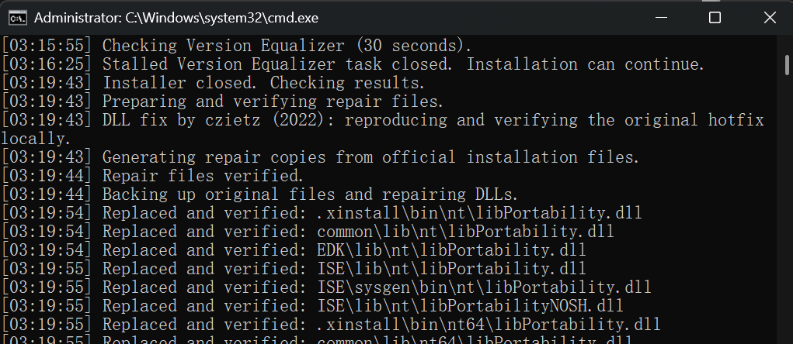 | 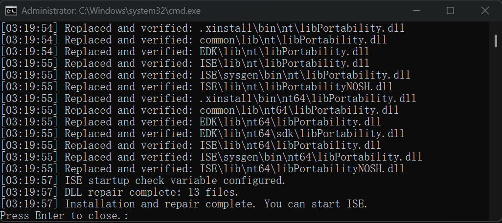 |

所有修复完成后，辅助会显示完成提示。此时按 **Enter** 退出，即可启动ISE。

## 9. 启动ISE并配置许可证

修复完成后，双击桌面的ISE快捷方式，打开 **ISE Project Navigator**。正常情况下，应能进入主界面，不再弹出VC运行环境检查报错窗口。

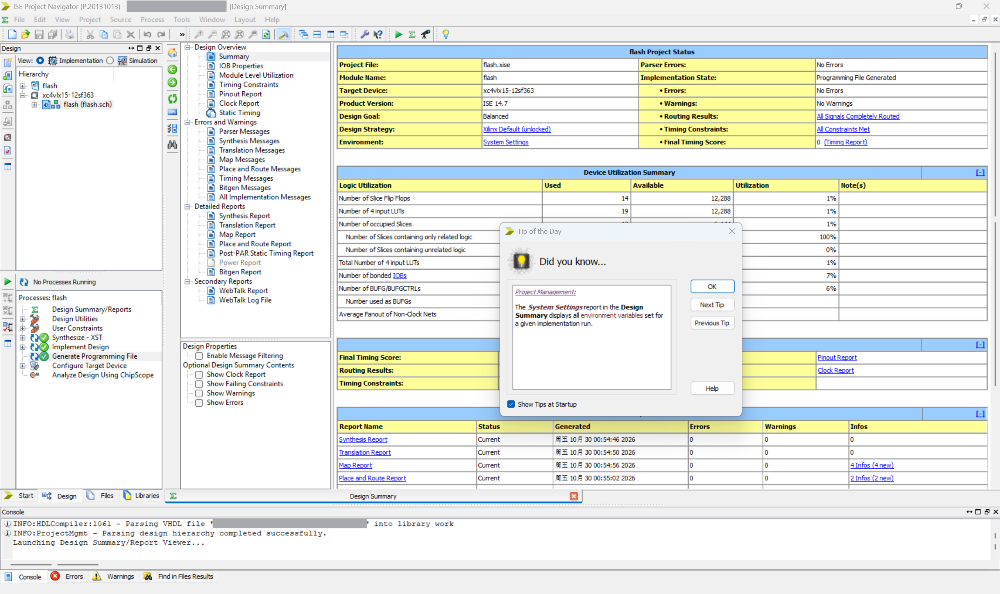

接下来正常导入自己的许可证，即可开始使用ISE。
